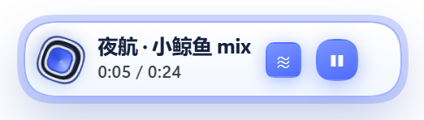
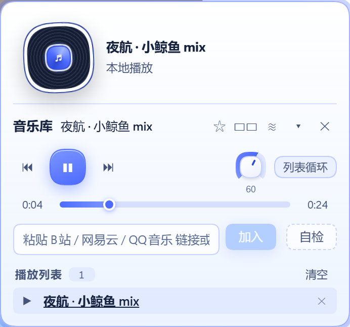
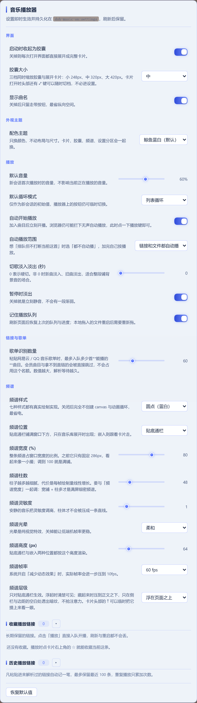

# dsh-music-on

A music dock for the DSH (DeepSeek Harness) Web GUI. A draggable capsule sits in the
bottom-right corner; click it and a player card opens: drag a local audio file in and it
plays, paste a Bilibili / NetEase Cloud Music / QQ Music playlist link and the tracks are
resolved into the queue, and a blue-white spectrum runs along the bottom of the page.

- **Does not modify any host file** — it only uses the host's public extension points (slots / services / routes).
- **No build step on the host side** — the host serves a plugin's client code without transformation, so everything is written with `react.createElement` rather than JSX syntax.
- **Honest degradation** — tracks whose direct link cannot be obtained (membership / licensing) are skipped rather than queued as unplayable entries.

## Features

- **Playback** — queue, previous / next, draggable progress bar, volume knob (hover and scroll the wheel), three loop modes, cross-fade on pause.
- **Drop in local audio** — drop a file onto the card and it queues and plays. mp3 / wav / ogg / m4a / flac / aac / opus / webm.
- **Paste links** — Bilibili videos, NetEase Cloud Music playlists and tracks, QQ Music playlists and tracks, direct audio URLs. Several at once, even mixed.
- **Spectrum** — six renderers: dots / bars / blocks / mirror / line / wave, with adjustable width, bar count, sensitivity, glow, height, frame rate, layering, and either a full-width strip along the bottom or embedded in the card.
- **Seven colour themes** — Whale blue-white (default), Aurora, Mint, Sunset, Rose, Neon, Mono.
- **Covers** — platform tracks use the track's own album cover, Bilibili tracks use the video cover.
- **Settings page** — `Settings → Music`, in five groups: interface / appearance theme / playback / links & playlists / spectrum.
- **Favorites and history** — two tables in Settings; any saved or recently played link replays in one click.

## Install

```sh
dsh plugin --profile web add github:lilcandi/dsh-music-on
```

Then reload the page (`Ctrl+F5`). The music capsule should appear in the bottom-right corner.

## Screenshots

| Collapsed capsule | Player card |
| --- | --- |
|  |  |

| Spectrum strip | Settings |
| --- | --- |
|  |  |

The same files are declared in `screenshots.json`, which is what storefronts read
for ordering. They are rendered from the live GUI by `scripts/shoot-screenshots.py`
(Playwright), so they are also a visual regression check: re-running it after a CSS change
shows immediately if something drifted.

The script does not just take empty screenshots. It dispatches a real `drop` event onto the
card, handing the plugin a 24-second WAV synthesised inside the page, waits for autoplay and
the spectrum to spin up, then shoots the capsule, card, spectrum strip and settings page. A
clean run is therefore an end-to-end check of drop-to-play; if that path breaks, the spectrum
shot comes out as a flat noise floor.

## Requirements

- DeepSeek Harness Web GUI `0.2.0-rc.1` and newer, below `0.3.0`.
- A desktop browser. Audio playback needs one user gesture before it can start (browser autoplay policy).

## How it works

The plugin has two halves.

The **host half** (`src/host/**`) registers two HTTP routes on the host's own connection
service, because a browser cannot fetch Bilibili audio directly (Referer checks) and because
resolving a NetEase / QQ playlist needs a server-side request to that platform's API:

| Route | Why it exists |
| --- | --- |
| `/api/dsh-music-on/resolve` | Resolves a platform URL into playable tracks |
| `/api/dsh-music-on/stream` | Proxies the audio stream so it can enter `AudioContext` and produce a real spectrum |

For NetEase and QQ Music the host does not hand the browser a plain audio URL: it signs an
**opaque HMAC token** and the browser only ever receives
`/api/dsh-music-on/stream?mt=<token>`. Their CDNs are not on the Bilibili allow-list, so
letting the client pass a plain `?src=` would turn that route into an open proxy. The token
carries the real URL, the MIME type and an expiry (10 minutes), and only the host can verify it.

The **browser half** (`src/client/**`, bundled into a single `client.js`) registers a
`shell.overlay` slot for the bottom-right dock, a `settings.section` slot for the settings
page, and keeps a right-sidebar tab form as well.

## License

MIT.

